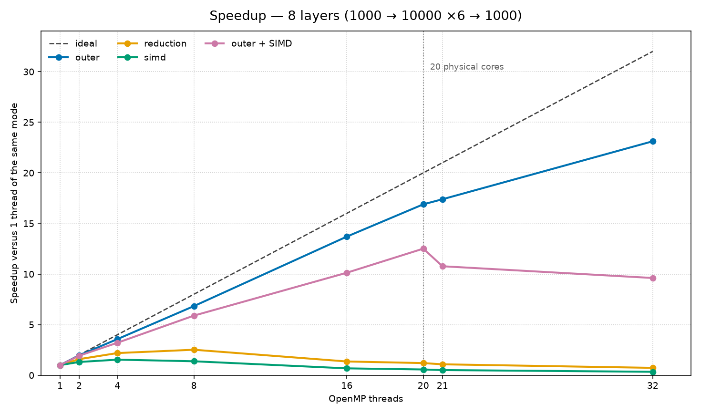
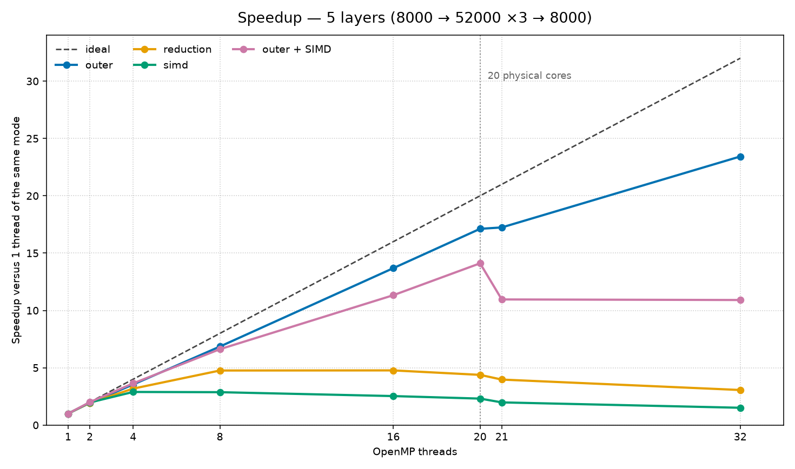

# Neural network inference with OpenMP

Course project on parallel programming. The program times **one inference** of a fully connected network with ReLU, using four ways to parallelize the dot product of each layer.

The measurements were collected on UFRGS servers with Intel VTune (`hpc-performance`). Threads were pinned with `OMP_PROC_BIND=close` and `OMP_PLACES=cores`. The machine used for these numbers has **20 physical cores**. Each point below is a separate profiler run.

Speedup for a mode is `time(1 thread) / time(P threads)` **of that same mode**. A smaller speedup can still be the fastest wall-clock time when the one-thread baseline is already shorter.

## Modes

| Mode | What is parallel |
| --- | --- |
| `outer` | Neuron loop with `#pragma omp parallel for`. The dot product is scalar. |
| `reduction` | Neurons run in sequence. The dot product uses `#pragma omp parallel for reduction(+:sum)`. |
| `simd` | Same as `reduction`, with `#pragma omp parallel for simd reduction(+:sum)`. |
| `outer_simd` | Neurons in parallel and `#pragma omp simd` on the dot product, without `reduction`. |

`outer` and `outer_simd` open **one** parallel region per layer and split neurons with `schedule(static)`. Weight initialization uses the same schedule (first touch), and the profiler reported **0% remote NUMA accesses**.

`reduction` and `simd` open a parallel region **per neuron**. Creating the team and synchronizing the reduction dominates when a layer has thousands of neurons.

## Build and run

Requirements: CMake and a compiler with OpenMP. The profiler scripts also need Intel VTune on `PATH`.

One run, without the profiler:

```bash
cmake -S . -B build -DCMAKE_BUILD_TYPE=Release
cmake --build build -j --target nn_sweep

export OMP_PROC_BIND=close OMP_PLACES=cores OMP_DYNAMIC=false
./build/nn_sweep outer 8 standard
./build/nn_sweep outer_simd 8 wide5
```

Usage: `nn_sweep <outer|reduction|simd|outer_simd> <threads> [standard|wide5]`.

| Benchmark | Network | What is timed |
| --- | --- | --- |
| `standard` | 8 layers: 1000 → 10000 (×6) → 1000 | 1 inference |
| `wide5` | 5 layers: 8000 → 52000 (×3) → 8000 | 1 inference |

On the UFRGS servers, the same binaries were profiled with:

```bash
bash run_benchmark_8layers.sh
bash run_benchmark_5layers.sh
bash run_outer_simd_vtune.sh standard
```

Thread counts: 1, 2, 4, 8, 16, 20, 21, and 32. To redraw the charts in this repository from `resultados/dados/`:

```bash
python3 plot_speedup.py
```

## Results

Tables use the wall-clock time of **one** inference. Efficiency is speedup / threads.

### 8 layers



| Mode | 1 thread | 20 threads | 32 threads | Speedup at 20 | Speedup at 32 |
| --- | ---: | ---: | ---: | ---: | ---: |
| outer | 0.700 s | 0.041 s | 0.030 s | 16.9× | 23.1× |
| outer + SIMD | 0.282 s | 0.023 s | 0.029 s | 12.5× | 9.6× |
| reduction | 0.717 s | 0.595 s | 0.979 s | 1.2× | 0.73× |
| simd | 0.343 s | 0.601 s | 1.016 s | 0.57× | 0.34× |

`outer` stays close to the ideal line up to the 20 physical cores (84.5% efficiency at 20 threads, 72% at 32). The extra gain from 20 to 32 comes from hyper-threading: there is no free physical core left, so the curve bends.

`outer + SIMD` has the shortest wall-clock time (23 ms at 20 threads, against 41 ms for scalar `outer`). Its speedup looks smaller because the one-thread baseline already vectorizes the dot product and drops from 0.70 s to 0.28 s. Past 21 threads the time goes up: the inner loop is already using the vector units and memory bandwidth, and the 21st thread shares a physical core.

`reduction` and `simd` barely scale. `reduction` peaks at 2.5× with 8 threads and, at 32 threads, is slower than 1 thread. Each of the 10,000 neurons in a hidden layer opens a new parallel region.

### 5 wide layers



| Mode | 1 thread | 20 threads | 32 threads | Speedup at 20 | Speedup at 32 |
| --- | ---: | ---: | ---: | ---: | ---: |
| outer | 10.03 s | 0.586 s | 0.428 s | 17.1× | 23.4× |
| outer + SIMD | 4.58 s | 0.325 s | 0.420 s | 14.1× | 10.9× |
| reduction | 10.33 s | 2.36 s | 3.37 s | 4.4× | 3.1× |
| simd | 4.94 s | 2.14 s | 3.28 s | 2.3× | 1.5× |

The larger network shows the same shape, with more work per neuron. `outer` reaches 17.1× on 20 cores (86% efficiency). `outer + SIMD` is still the shortest wall-clock time: 0.325 s against 0.586 s for scalar `outer`. `reduction` does better than on the 8-layer network (peak 4.8× at 16 threads) because a dot product of height 52,000 dilutes the barrier cost, and it is still far from the outer loop.

On both benchmarks the profiler reported 0% remote NUMA accesses. `outer` leaves the ideal line because of clock (higher turbo with few threads), a rising CPI when cores contend for memory, and hyper-threading after the 20th thread.

## What is in Git

`resultados/` keeps the summary CSVs and the two charts. `.gitignore` leaves out the build directory (`build/`), profiler collections, logs, and slide copies.
